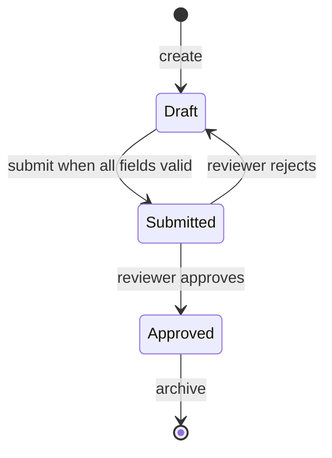
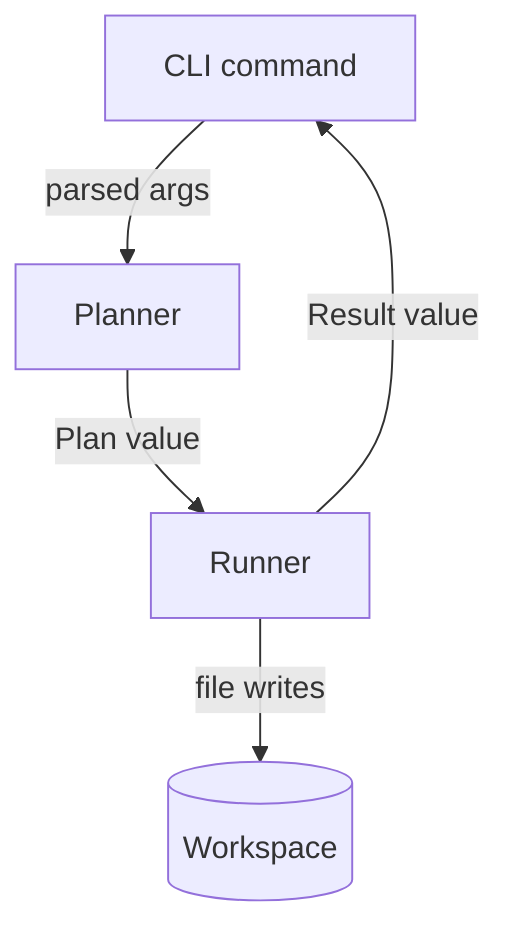

# Diagrams

Draw a fenced `mermaid` block wherever a sketch or rationale proposes or explains architecture, ownership boundaries or state transitions. A terminal may draw the block as ASCII, so every diagram has to read well there.

## Diagram types

| Use | Type | Label every edge with |
|---|---|---|
| Lifecycles, modes, transitions | `stateDiagram-v2` | its trigger or guard |
| Component boundaries, data flow | `flowchart TD` | its payload or contract |
| Calls between actors over time | `sequenceDiagram` | its message |
| Type shapes and their relations | `classDiagram` | its relation |
| Stored data and keys | `erDiagram` | its relation |

Use these five types only. Never use `gantt`.

## Terminal rendering

- Lay a flowchart out top to bottom with `TD`. Wide side-by-side `LR` subgraphs clip in a narrow terminal.
- Write labels in plain ASCII. HTML entities and ` ` tags print as literal text.
- Keep each diagram to 10 nodes or fewer. Split a larger system into several small diagrams, each answering one question.
- Name a node with the code's own identifier or a short role.

## Examples

